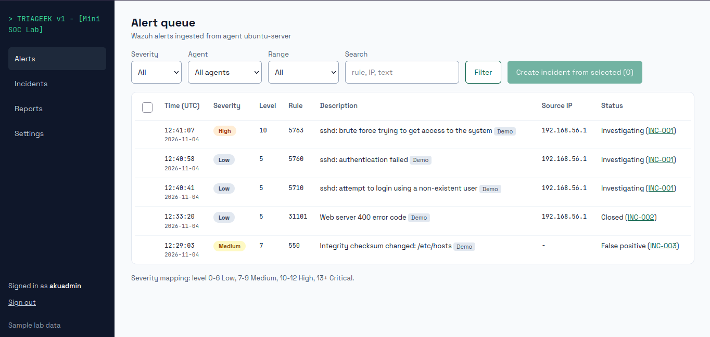

# TRIAGEEK - a Mini SOC Lab

A small Django case-management app for **Wazuh 4.x alerts**. It ingests alerts from the manager's
`alerts.json`, lets an analyst triage them into incidents (notes, escalation, false positives, closure),
and produces daily / weekly / monthly security reports in English.

> **This is a lab project.** The alerts come from attacks the author generated against their own VM.
> It is **not** production monitoring, and sample data is never presented as real operational data.



## Quick start (7 commands)

Requires [uv](https://docs.astral.sh/uv/) and Python 3.12+. Django 6.1 is installed by `uv sync`.

```bash
uv sync                                          # sync dependencies
cp .env.test .env                                # DEBUG on local
uv run python manage.py migrate                  # create the SQLite db
uv run python manage.py create_roles             # create the analyst or viewer groups
uv run python manage.py createsuperuser          # create superuser
uv run python manage.py seed_demo                # optional: add incident (samples) for demo
uv run python manage.py runserver                # run django on local
```

Run the tests with one command:

```bash
uv run python manage.py test
```

### Users and roles

| Role | Can do |
|---|---|
| `analyst` | Everything a viewer can, plus create incidents, add notes, edit, escalate, close, mark false positive, reopen |
| `viewer` | Read-only. Write endpoints answer **403** and the buttons are hidden |

Superusers pass every check. Create more users and put them in a group in `/admin/`
(Users, then the user, then Groups). Users in neither group are denied everything (403).
`create_roles` is idempotent; run it again after upgrades.

`seed_demo` also creates a demo user `analyst1` with **no usable password**
(run `uv run python manage.py changepassword analyst1` if you want to log in as it).

## Ingesting Wazuh alerts

```bash
uv run python manage.py ingest_alerts
uv run python manage.py ingest_alerts --follow --interval 5
uv run python manage.py ingest_alerts --path /some/alerts.json
```

* Default path: `$WAZUH_ALERTS_PATH`, then `/var/ossec/logs/alerts/alerts.json` (Wazuh 4.x, manager only).
* **Permissions:** that file is usually readable only by the `wazuh` user/group. Add the user that
  runs Django to the `wazuh` group (e.g. `sudo usermod -aG wazuh <django-user>`, then log in again).
  **Do not run Django as root.**
* Resumes from the stored byte offset; a changed inode or a file smaller than the offset (log
  rotation) restarts from 0. Re-running never creates duplicates (`wazuh_id` is unique).
* Malformed lines are logged and skipped. A last line without a newline is only consumed once it is
  complete JSON (Wazuh may still be writing it).
* A line needs an `id` and a parseable `timestamp`; otherwise it counts as malformed.
* Mapped fields: `id`, `timestamp`, `agent.name`, `rule.id`, `rule.level`, `rule.description`,
  `data.srcip` (falling back to `data.src_ip`), `full_log`. The complete object is kept in `Alert.raw`;
  absent fields are stored as null/empty, never invented.

## Demo data

`seed_demo` loads five alerts mirroring the mockup (rules 5763, 5760, 5710, 31101, 550; agent
`ubuntu-server`; source `192.168.56.1`; 4 Nov 2026, about 12:29 to 12:41 UTC) and three incidents.
Everything is flagged `is_demo=True`; the sidebar shows **Sample lab data** only while any exists,
alerts carry a "Demo" tag, and reports say "Sample data" / "Includes sample data".

```bash
uv run python manage.py seed_demo --alerts-only   # five "new" alerts to triage yourself
uv run python manage.py seed_demo --clear         # remove all demo data
```

## Severity mapping

One function (`alerts/severity.py`) is used by the queue, filters, incidents, reports and tests:

| Wazuh level | Severity |
|---|---|
| 0 to 6 | Low |
| 7 to 9 | Medium |
| 10 to 12 | High |
| 13 and above | Critical |

An incident's severity defaults to the highest among its alerts and can be edited by an analyst
(the change is written to the incident's notes).

## Triage rules (enforced in `incidents/services.py`)

* New incident from selected alerts: editable title (default: most severe alert's description plus
  source IP), severity = highest, status `new`, alerts become `investigating`. Only `new` alerts can be selected.
* Transitions: `new` to investigating/escalated/closed; `investigating` to escalated/closed;
  `escalated` to investigating/closed; `closed` to investigating (reopen).
* Closing, marking a false positive, and escalating (target `L2`) all **require a reason**.
  A false positive closes the incident and sets its alerts to `false_positive`.
* Every state change writes an `IncidentNote` with a `kind`, so the notes timeline is the audit trail.

## Reports

`/reports/` (daily, weekly Monday to Sunday, monthly; UTC). Includes incidents **created or closed**
in the period. The summary is generated from counts only. Export via **Print / Save as PDF**
(print stylesheet) or `?format=md` (Markdown download). There is no server-side PDF library.
Note that "current status" in a report is the status at the time you open it, not at period end.

## Configuration

All via environment variables (or `.env`, see `.env.example`): `DJANGO_DEBUG` (default **false**),
`DJANGO_SECRET_KEY`, `DJANGO_ALLOWED_HOSTS`, `DJANGO_CSRF_TRUSTED_ORIGINS`, `DJANGO_SECURE_COOKIES`
(defaults to on when DEBUG is off), `DJANGO_DB_PATH`, `WAZUH_ALERTS_PATH`.

Security notes: login required everywhere except the login page; CSRF on every POST; permissions
checked server-side; alert text is untrusted and always auto-escaped (no `|safe`). With DEBUG off
Django does not serve static files: run `collectstatic` and serve `staticfiles/` from your web server.
If `DJANGO_SECRET_KEY` is unset a random key is generated per process (sessions reset on restart).
`manage.py check --deploy` also reports HSTS / SSL redirect, which depend on how you deploy.

## Limitations

* Severity is a simple level lookup; there are no custom detection rules inside the app.
* Single-agent lab in mind (multiple agents work in the queue, but nothing is tuned for fleets); no multi-tenant support.
* No real-time push: ingest is polling (`--follow`), the UI needs a page refresh.
* Only SQLite is tested. Alerts are stored once; there is no retention or archiving.
* Escalation target is a fixed `L2` label; nothing is sent anywhere.
* Reports show current incident status, not a historical snapshot.
* Visual match with the mockup was built from its written spec and screenshots; it was not
  pixel-compared in a browser.
